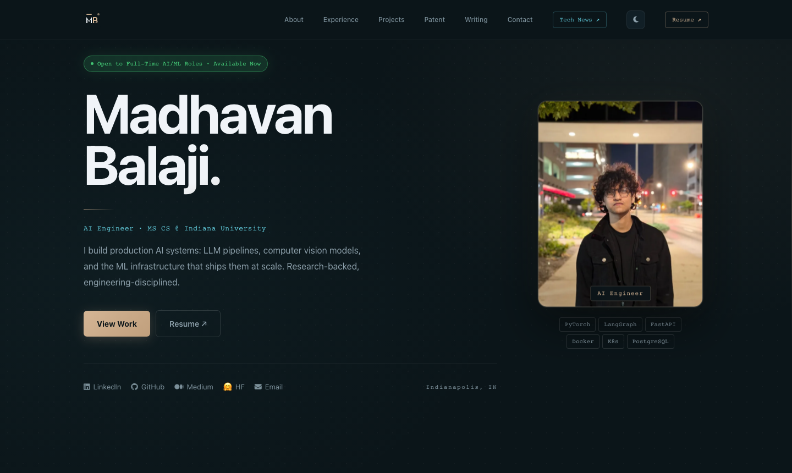
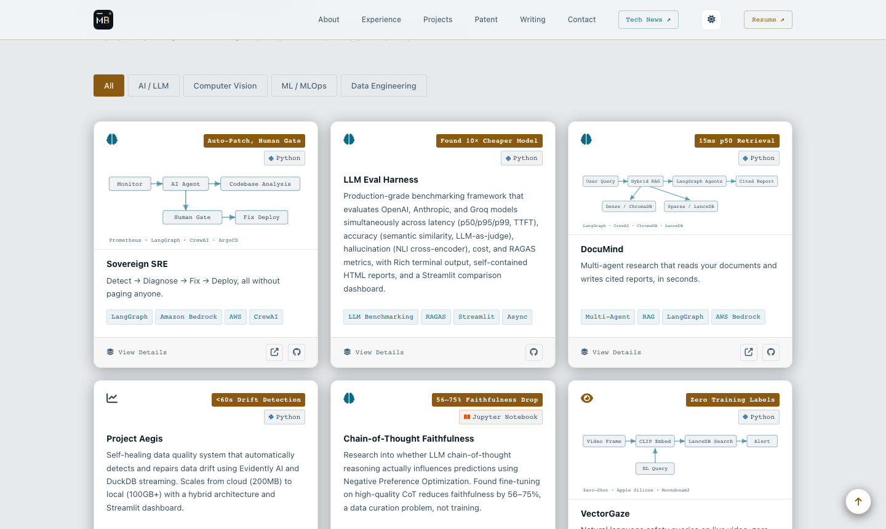
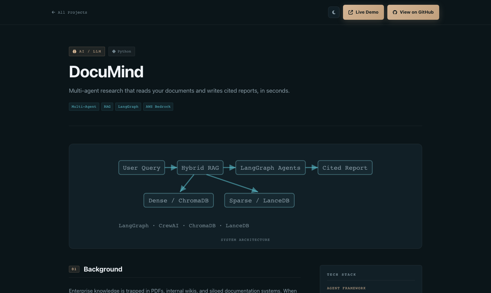
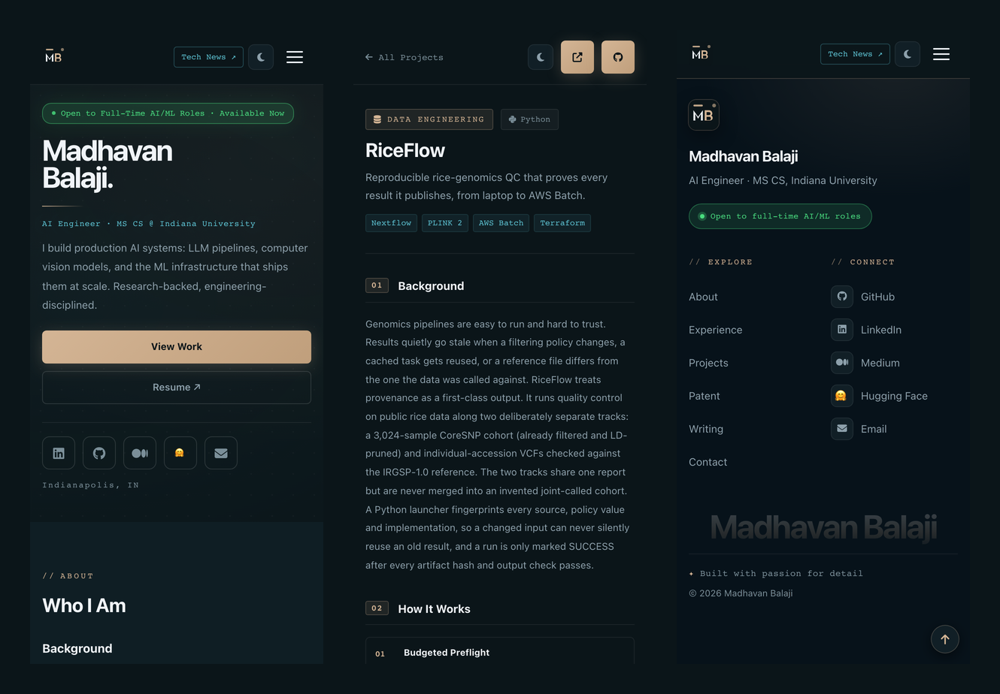
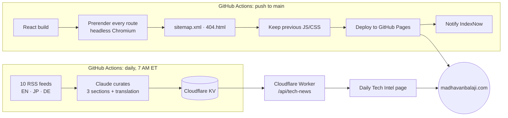

<div align="center">

# Madhavan Balaji · Portfolio

**AI Engineer · MS Computer Science, Indiana University**

Personal portfolio for production AI work: LLM systems, computer vision, data pipelines and MLOps.

[**madhavanbalaji.com**](https://madhavanbalaji.com) ·
[Resume](https://madhavanbalaji.com/resume.pdf) ·
[LinkedIn](https://www.linkedin.com/in/madhavanbalaji/) ·
[Hugging Face](https://huggingface.co/madhavan02) ·
[Medium](https://medium.com/@madhavanbalaji02)

[](https://github.com/madhavanbalaji02/madhavan-portfolio/actions/workflows/static.yml)
[](https://github.com/madhavanbalaji02/madhavan-portfolio/actions/workflows/daily-news.yml)



</div>

---

## Overview

A React single-page app that is **prerendered to static HTML** at build time, so every page is fast, crawlable and shareable, then becomes fully interactive once JavaScript loads. It showcases 14 projects with dedicated case-study pages, a patent, teaching experience, writing, and **Daily Tech Intel**: an AI-curated news briefing refreshed every morning by a scheduled Claude pipeline.

<table>
  <tr>
    <td width="50%"></td>
    <td width="50%"></td>
  </tr>
  <tr>
    <td align="center"><sub>Project grid (light theme), filterable by category</sub></td>
    <td align="center"><sub>Project case study with its architecture diagram</sub></td>
  </tr>
</table>

<div align="center">
  
  <br /><sub>Phone layouts: home, project page, footer</sub>
</div>

## Highlights

| | |
|---|---|
| **Prerendered for SEO** | Every route is rendered to static HTML after the React build, with its own title, meta description, canonical URL, Open Graph tags and JSON-LD (`Person`, `WebSite`, `SoftwareSourceCode`, `BreadcrumbList`). A sitemap is generated from the project data. |
| **Search engines notified on deploy** | Each deploy submits the sitemap to IndexNow, so Bing and its partners recrawl immediately. |
| **Accessible** | Text colors meet WCAG AA contrast in both themes, there's a visible keyboard focus ring, 44px touch targets on touch screens, labelled icon-only controls and `prefers-reduced-motion` support. |
| **Every form factor** | Verified across 19 viewport sizes, from a 280px Galaxy Fold cover screen to a 3440px ultrawide, including tablets, foldables and phone landscape. |
| **Light and dark themes** | One token-based palette: gold for actions, cyan for labels and code, green for status only. Tints derive from base tokens with `color-mix()`. |
| **Small footprint** | ~86 kB JS and ~12 kB CSS gzipped; the project and news pages are code-split. |
| **Zero-downtime deploys** | The previous builds' JS/CSS stay online after each deploy, so a visitor holding a cached page never gets an unstyled one. |

## Tech stack

| Area | Tools |
|---|---|
| Frontend | React 18, React Router 6 (`BrowserRouter`), plain CSS with custom properties |
| Build | Create React App, Playwright (headless Chromium) for prerendering |
| Hosting | GitHub Pages via GitHub Actions, custom domain |
| News pipeline | Node.js, Anthropic Claude (`claude-sonnet-4-6`), Cloudflare Workers + KV |
| SEO | Per-page metadata hook, JSON-LD, sitemap, robots.txt, IndexNow |

## Architecture



### Prerendering

`scripts/prerender.mjs` runs after `react-scripts build`. It serves `build/` the way GitHub Pages will, loads `/` and every `/project/<slug>/` in headless Chromium, and saves the rendered HTML to `build/<route>/index.html`. It also writes `sitemap.xml`, a `404.html` fallback (served with a real 404 status) and the shell for `/tech-news/`.

Project routes come straight from `src/components/projectsData.js`, so a new project is picked up automatically. The build fails if any page renders without its heading.

### Per-page SEO

`src/seo.js` exports `useSeo()`. Each page declares its title, description, canonical path, robots directive and structured data, and the prerender captures them into the static HTML. The Tech News page and the 404 page are `noindex`.

## Daily Tech Intel

An AI-curated briefing of global AI research and tech news, at [`/tech-news/`](https://madhavanbalaji.com/tech-news/).

1. **Every morning at 7 AM New York time**, a GitHub Action runs `server/refresh.js`. The job runs on both UTC offsets and skips the one that doesn't match daylight saving time.
2. It fetches **10 RSS feeds** concurrently: TechCrunch, The Verge, Hacker News, Ars Technica, the Hugging Face blog, arXiv cs.AI / cs.LG / cs.CV, Gigazine (Japanese) and Golem.de (German). `Promise.allSettled()` means one failing feed never sinks the run.
3. **Claude** sorts the stories into three sections (*For You*, *My Stack*, *Around the World*), writes summaries and translates the Japanese and German stories into English. The static system prompt uses prompt caching.
4. The result is written to **Cloudflare KV**. A **Cloudflare Worker** (`worker/`) serves it at `/api/tech-news`, and generates on-demand per-article deep analysis at `/api/tech-news/analyze`, cached for 7 days.

## Getting started

**Prerequisites:** Node.js 18+ and npm.

```bash
git clone https://github.com/madhavanbalaji02/madhavan-portfolio.git
cd madhavan-portfolio
npm install
npx playwright install chromium   # needed by the prerender step of `npm run build`
npm start                          # http://localhost:3000
```

| Command | What it does |
|---|---|
| `npm start` | Development server with hot reload |
| `npm run build` | Production build plus prerender of every page, written to `build/` |
| `npm run build:spa` | Production build only, no prerender |

The Tech News page reads from the deployed Worker, so it works in development with no extra setup. To try the news curation job locally:

```bash
cd server && npm install
cp .env.example .env      # then add your ANTHROPIC_API_KEY
node refresh.js           # writes /tmp/news-data.json; does not publish anything
```

## Project structure

```
├── .github/workflows/
│   ├── static.yml            # build → prerender → deploy → IndexNow
│   └── daily-news.yml        # 7 AM ET news curation → Cloudflare KV
├── public/                   # index.html (site-wide JSON-LD), icons, resume, robots.txt
├── scripts/
│   ├── prerender.mjs         # static HTML for every route + sitemap
│   ├── keep-previous-assets.mjs
│   └── indexnow.mjs
├── server/                   # Daily news curation job (RSS + Claude)
├── worker/                   # Cloudflare Worker serving the news API
└── src/
    ├── App.js                # routes: /, /project/:slug/, /tech-news/, 404
    ├── seo.js                # useSeo(): per-page metadata and JSON-LD
    ├── index.css             # design tokens, all component styles, breakpoints
    └── components/
        ├── projectsData.js   # single source of truth for all projects
        ├── ProjectDetail.js  # project case-study page
        ├── ProjectDiagrams.js
        └── …                 # Hero, About, Experience, Projects, Footer, etc.
```

## Adding a project

1. Add an entry to `src/components/projectsData.js`: `slug`, `title`, `tagline`, `description`, `category` (`ai` · `cv` · `ml` · `data`), `metric` (an outcome, not a count), `github`, an optional `demo`, and the detail fields `background`, `workflow`, `results`, `highlights` and `techStack`.
2. Optionally, add an architecture diagram to `src/components/ProjectDiagrams.js` and register it in `diagramsBySlug`.
3. Push to `main`. The card, the `/project/<slug>/` page, its sitemap entry and the search engine notification are all generated by the build.

## Deployment

Pushing to `main` deploys automatically through `.github/workflows/static.yml`:

1. Install dependencies and Chromium.
2. `npm run build`: the React build plus the prerender.
3. Carry over the previous deploys' JS/CSS.
4. Publish `build/` to GitHub Pages.
5. Submit the sitemap to IndexNow.

If any step before publishing fails, the live site stays on the last good version.

## License

© 2026 Madhavan Balaji. All rights reserved. The code is shared for reference; the written content, images and personal materials may not be reused without permission.
